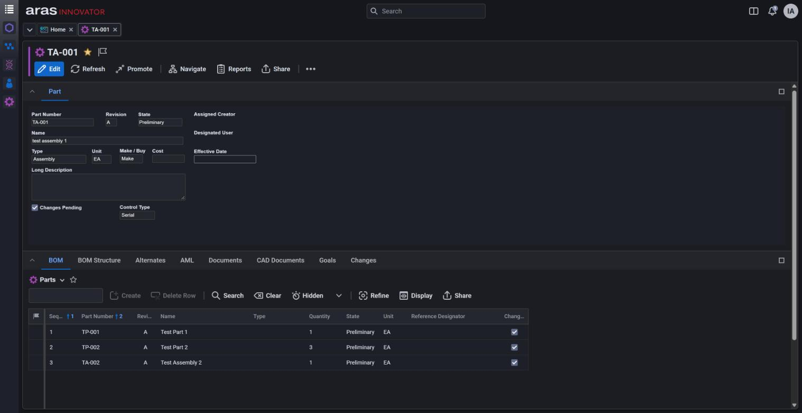
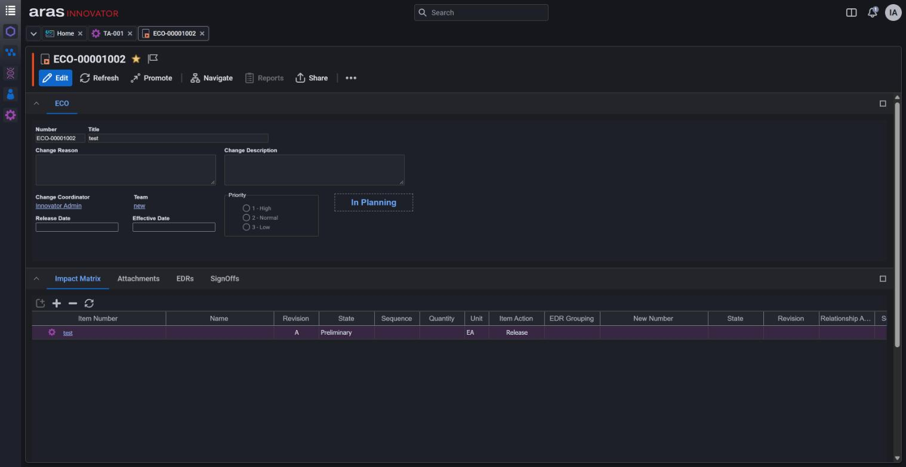
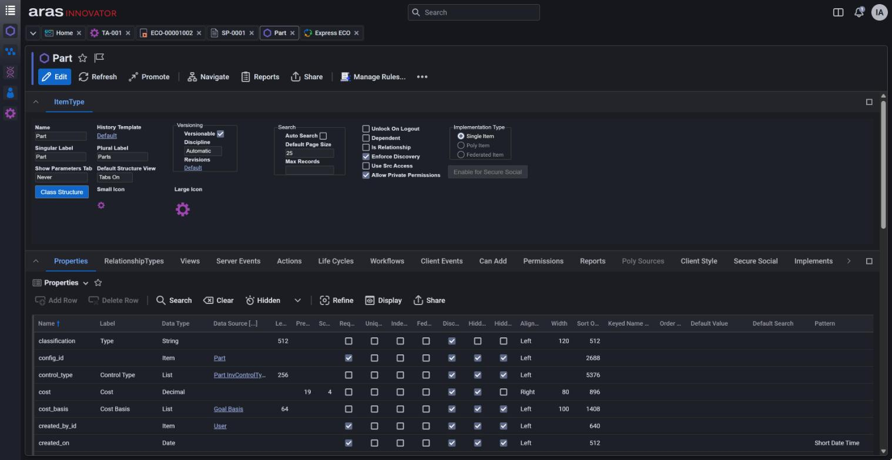
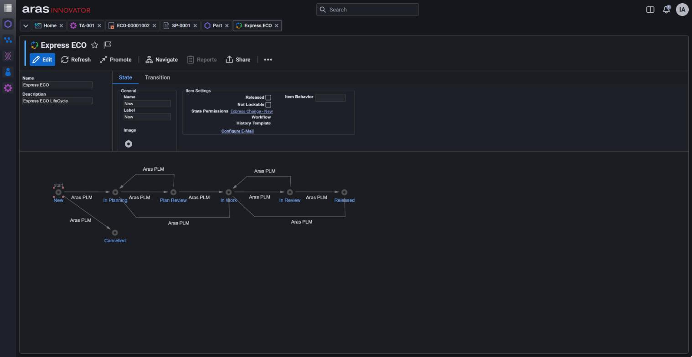

# Aras Innovator Dark Mode

A dark theme for Aras Innovator. Light mode is left as it is; each user picks a theme in the user menu.

Aras Innovator 2025 with the dark theme applied:

| | |
|:---:|:---:|
| <br>Part with its BOM | <br>Express ECO with its Impact Matrix |
| <br>ItemType form (administration) | <br>Life Cycle Map editor |

## Tested versions

| Aras Innovator | Client version | Browser |
|---|---|---|
| 2025 | 14.35.0.44037 | Google Chrome |
| 2024 | 14.0.25.40942 | Google Chrome |

For any other version, see [New Aras versions](#new-aras-versions).

## Requirements

- Windows PowerShell 5.1 or PowerShell 7, run **elevated** on the Aras server.
- Nothing to install: the script uses the install's own `Innovator\Client\nodejs\node.exe`.
- You must be licensed by Aras to modify the install you apply this to. Check your agreement with Aras first.

## Apply

```powershell
$aras = 'C:\Program Files (x86)\Aras\Innovator2025'

# 1. Preview (writes only to <install>\DarkModeKit\.staging and .snapshot)
& .\DarkModeKit\apply-darkmode.ps1 -Target $aras -DryRun

# 2. Apply
& .\DarkModeKit\apply-darkmode.ps1 -Target $aras

# 3. Restart the Client application so browsers pick up the new files
(Get-Item "$aras\Innovator\Client\web.config").LastWriteTime = Get-Date
```

The script copies `DarkModeKit\` into the install root and runs from there. Running it a second time should report `0 written`.

Keep one copy of the kit as your master copy, and make every change described below in that copy. Each run from that copy overwrites `<install>\DarkModeKit\`. After any change, run steps 2 and 3 again.

### What it changes

- **Adds** `<install>\DarkModeKit\`, `Innovator\Client\darkmode\`, `Innovator\Client\images-dark\` and `OAuthServer\wwwroot\css\darkmode\`.
- **Edits** existing files only inside `aras-darkmode:begin` / `aras-darkmode:end` markers: two lines in each client page, and one line at the top of the login stylesheets. It also bumps `filesRevision` in `Innovator\Client\InnovatorClient.config`.

The original bytes of every file it edits are kept in `<install>\DarkModeKit\.snapshot\`. Other tools' marker blocks (`aras-<name>:begin` to `aras-<name>:end`) in the same pages are left in place.

### Options

| Option | Meaning |
|---|---|
| `-Target <root>` | Install root: the folder that holds `Innovator\` and `OAuthServer\` |
| `-DryRun` | Plan only; nothing outside `<install>\DarkModeKit\` is written |
| `-NoBump` | Don't change `filesRevision`. Browsers may then keep serving cached files. |
| `-Uninstall` | Remove the marker blocks and output folders |
| `-Node <node.exe>` | Use a different `node.exe` |
| `-Snapshot <dir>` | Keep the snapshot of original files somewhere other than `<install>\DarkModeKit\.snapshot` |
| `-Skip <steps>` | Troubleshooting only: leaving out a step produces an incomplete theme |

### Remove

```powershell
& .\DarkModeKit\apply-darkmode.ps1 -Target $aras -Uninstall
(Get-Item "$aras\Innovator\Client\web.config").LastWriteTime = Get-Date
```

This removes the marker blocks and the three output folders, and bumps `filesRevision` again so browsers drop the dark files. Afterwards, delete `<install>\DarkModeKit\` by hand.

### After an Aras upgrade, a hotfix or another package

If a client page changes, the next apply stops before writing anything and reports that the page differs from its snapshot. Delete `<install>\DarkModeKit\.snapshot`, then apply again.

## Switching themes

Open the user menu (your initials, top right) and choose **Theme**:

| Choice | Result |
|---|---|
| Light | The standard Aras look |
| Dark | The dark theme |
| Use system setting | Follows the Windows or macOS light/dark setting, and changes along with it |

- The change applies at once to every open window and tab of the client in that browser. No reload is needed.
- The choice is remembered per browser and per server address, not per Aras user. Until someone picks a theme, the client is light.
- The login page can't read that choice, so it follows the operating system's light/dark setting.

## New Aras versions

The script reads the client version from `Innovator\Client\bin\Aras.Client.dll` and uses the matching file in `DarkModeKit\anchors\`. If no file matches, it uses the nearest version and prints a warning.

To add a version:

1. Copy the nearest file in `anchors\`, for example `14.35.json` to `14.36.json`.
2. In the copy, set `"version"` and `"detect": { "clientVersion": "14.36.*" }`.
3. If Aras changed its colour palette in that version, update `"ramp"` (the grey scale, light to dark) and `"light"` (the light value of each role) from the version's `styles\less\core\variables.less`.
4. Entries limited to versions with `"anchors"` (see below) don't apply to the new version until you add it to their lists. Check every entry with an `"anchors"` list in `exceptions\overrides.json`.
5. Run with `-DryRun`, then open `<install>\DarkModeKit\.staging\KIT-COVERAGE.md`:
   - **2. Selectors exist in this version's CSS** lists rules whose target no longer exists: Aras renamed or removed it.
   - **4. Injection targets** lists client pages that were not found.
   - **6. Hook anchors** lists script hooks that no longer match the new client code.
6. Apply, restart, and go through the client in dark mode. Fix what is left with the entries described next.

## Version-specific exclusions and inclusions

All adjustments are JSON data. There's no need to change the scripts.

| File | Use |
|---|---|
| `exceptions\overrides.json` | Colour adjustments shared by all versions |
| `exceptions\icons.json` | Icon recolouring |
| `anchors\<version>.json` | Palette for one version, plus that version's own adjustments |

**Limit a shared entry to some versions.** Add an `"anchors"` list to an entry of `rules`, `roles`, `keepLight` or `inlineLiterals` in `overrides.json`. The entry is then used only for the listed versions:

```json
{
  "selector": ".aras-navigation-panel-tabs .aras-tabs__icon",
  "decls": "background-color: var(--dm-surface-raised)",
  "anchors": ["14.35"]
}
```

**Add an entry for one version only.** Put it under `"exceptions"` in that version's anchors file, using the same keys as `overrides.json`. List entries are added to the shared lists. `roles` entries are placed first, so they win over the shared ones. Objects such as `files` and `entryPoints` are merged key by key.

```json
"exceptions": {
  "rules": [
    { "selector": "#formsPanel", "decls": "border-bottom-color: var(--dm-border-subtle)" }
  ],
  "files": { "include": ["^Innovator/Client/customer/.*\\.css$"] },
  "entryPoints": { "add": ["scripts/promoteDialog.html"] }
}
```

The 2024 anchors file (`14.0.25.json`) uses this for the Promote dialog, a separate page that only exists in that version.

**Exclude something from the theme.**

| Goal | Entry |
|---|---|
| Leave a stylesheet as it is | Add a regex for its path to `files.exclude` |
| Keep a stylesheet or a selector light | Add `{ "file": "<path regex>" }` and/or `{ "selector": "<selector regex>" }` to `keepLight` |
| Leave an icon as it is | Add its path under `Innovator\Client\images\`, without `.svg`, to `noRemap` in `icons.json` |

## Custom client components

Components that run inside standard Aras pages (Methods, Forms, dashboards, item views) load the dark theme already. What remains is their colours.

### Stylesheets you own

The simplest route is to give your component its own dark rules. Use the `--dm-*` colours, which exist on every themed page while dark mode is on. They don't depend on the kit's lists and survive every re-apply.

```css
html[data-theme="dark"] .my-widget {
  background-color: var(--dm-surface-raised);
  color: var(--dm-text);
  border-color: var(--dm-border-subtle);
}
```

Commonly used colours:

| Colours | Names |
|---|---|
| Surfaces | `--dm-surface`, `--dm-surface-raised`, `--dm-surface-canvas`, `--dm-surface-header` |
| Text | `--dm-text`, `--dm-text-strong`, `--dm-text-secondary`, `--dm-text-muted`, `--dm-text-disabled`, `--dm-link` |
| Borders | `--dm-border`, `--dm-border-subtle`, `--dm-border-input` |
| Accents | `--dm-primary`, `--dm-primary-text`, `--dm-on-accent`, `--dm-focus` |
| States | `--dm-selection`, `--dm-highlight-row`, `--dm-error`, `--dm-error-text`, `--dm-success`, `--dm-warning`, `--dm-icon` |

### Letting the kit convert a stylesheet

Stylesheets under `Innovator\Client\styles`, `Modules`, `scripts` and `Solutions` are converted automatically on the next apply. For anywhere else, add the path to `files.include` in `overrides.json`, for example `"^Innovator/Client/customer/.*\\.css$"`.

The dark rules are shared by all pages, so selectors made only of common class names (such as `.button` or `.header`) are dropped. They are listed under `droppedGenericSelectors` in `<install>\DarkModeKit\.staging\report\coverage-css.json`. To keep them, limit the file to the pages that load it with a `scopes` entry: the key is a path regex, and the value matches the page's `<link>`:

```json
"scopes": {
  "customer/my-widget/styles\\.css$": "link[href*=\"my-widget/styles.css\"]"
}
```

### Single elements

| Situation | Entry in `overrides.json` |
|---|---|
| One element needs a different colour | Add to `rules`: `{ "selector": "...", "decls": "color: var(--dm-text)" }`. The selector is applied only in dark mode. `decls` may be a string or a list. |
| A script writes a colour into a `style="..."` attribute | Add to `inlineLiterals`: `{ "site": "my widget link", "element": "span", "prop": "color", "literals": ["#3668b1"], "token": "--link" }`. `site` is a label only. |

### Pages with their own `<head>`

A standalone page, such as an HTML file under `Innovator\Client\customer\`, needs the two marker lines to load the theme. To find pages the kit doesn't reach, pass the anchors file for your version:

```powershell
& "$aras\Innovator\Client\nodejs\node.exe" .\DarkModeKit\lib\inject-entrypoints.mjs --target $aras --anchors .\DarkModeKit\anchors\14.35.json --discover
```

List the pages, as paths relative to `Innovator\Client`, under `entryPoints` in `overrides.json`:

```json
"entryPoints": {
  "add": ["customer/my-page/index.html"],
  "ignore": ["customer/old-test/index.html"]
}
```

- **`add`**: on the next apply, the page gets its marker lines and is saved to the snapshot. Its own `<style>` blocks are converted too, for that page only.
- **`ignore`**: only stops `--discover` from listing a page you don't want themed, such as one that is never opened.
- **One version only**: if a page exists in only one Aras version, put the same `entryPoints` block under `"exceptions"` in that version's anchors file instead.

### Icons

Only SVG icons under `Innovator\Client\images\` get dark copies. Icons kept elsewhere keep their colours; give them dark versions in your own stylesheet.
